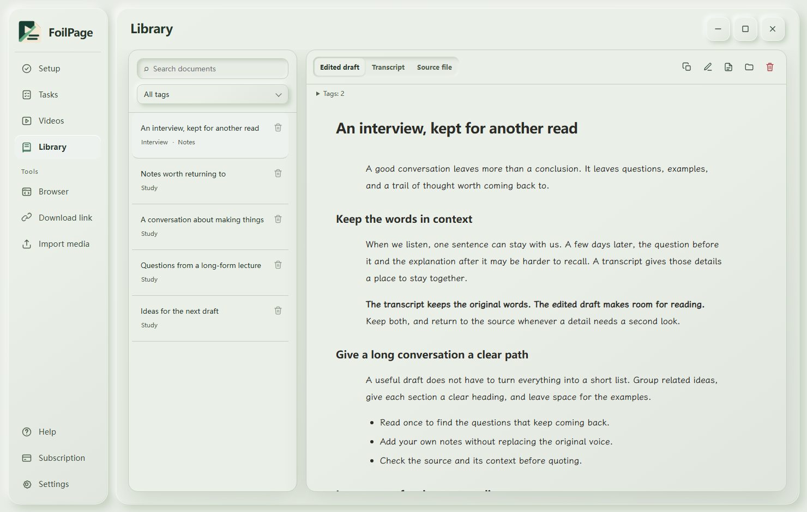
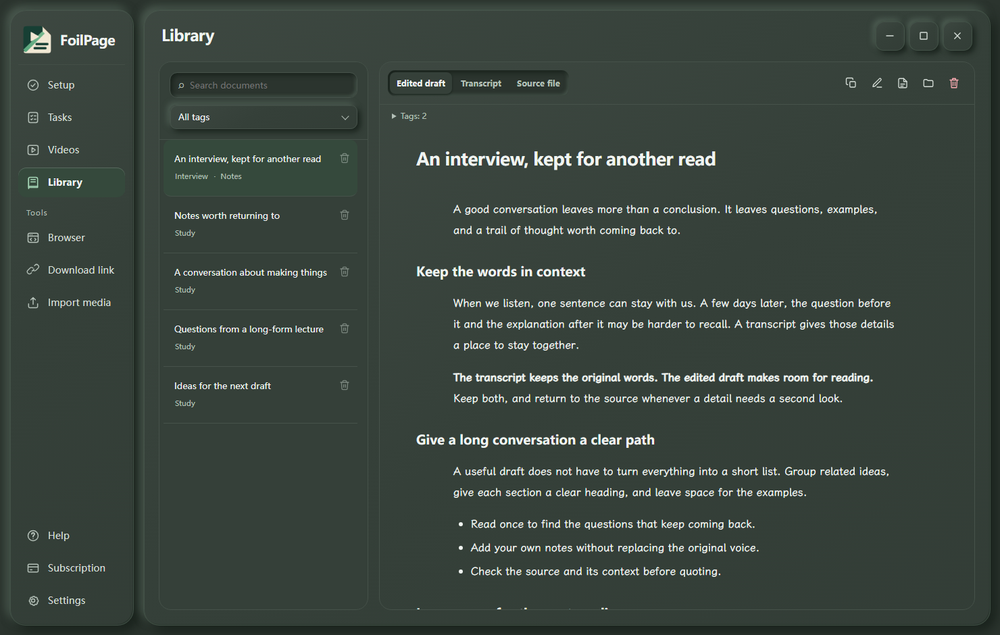

<picture><source media="(prefers-color-scheme: dark)" srcset="assets/home/hero-en-dark-v4.svg"></picture>

<h1 align="center">FoilPage</h1>

<strong>Video download, local transcription, and an editable library for Windows.</strong>

<a href="https://foilpage.early-snipe-7202.chatgpt.site/?lang=en"><strong>Visit the website</strong></a> · <a href="https://foilpage.early-snipe-7202.chatgpt.site/?lang=zh"><strong>简体中文官网</strong></a>

<a href="https://github.com/Ansel-Poiesis/FoilPage-releases/releases/latest"><picture><source media="(prefers-color-scheme: dark)" srcset="assets/home/action-download-en-dark-v3.svg"></picture></a>
<a href="https://foilpage.early-snipe-7202.chatgpt.site/#start"><picture><source media="(prefers-color-scheme: dark)" srcset="assets/home/action-guide-en-dark-v3.svg"></picture></a>
<a href="https://github.com/Ansel-Poiesis/FoilPage-releases/releases"><picture><source media="(prefers-color-scheme: dark)" srcset="assets/home/action-releases-en-dark-v3.svg"></picture></a>
<a href="https://github.com/Ansel-Poiesis/FoilPage-releases/issues"><picture><source media="(prefers-color-scheme: dark)" srcset="assets/home/action-feedback-en-dark-v3.svg"></picture></a>

## Keep the words. Keep working with them.

FoilPage brings video download, on-device transcription, and document editing into one Windows workspace. Start from a supported Douyin, Bilibili, or YouTube link, or import local video and audio. Keep the original transcript and refine a separate draft when you need one.

- **Work locally.** Sign in and transcribe with a downloaded local model. CPU support is included; a matching NVIDIA GPU pack is optional.
- **Build a useful library.** Search documents, organize them with tags, switch between transcript and edited draft, then edit, copy, or export.
- **Connect your workflow.** Pair the Chrome / Edge extension, or connect MCP and CLI to the running desktop app.
- **Choose online processing.** Cleanup and title refinement are optional. Relevant text is sent to the selected service; your own API follows its provider's terms.

Local transcription does not upload media or transcripts and does not consume hosted cloud credits. Setup, account verification, and model downloads need a network connection. Platform downloads depend on the source, browser sign-in, and network conditions.

## Light and dark

 

The screenshots use sample content and the development interface. The English interface switch is in source and is not included in the current 1.3.10 installer. [View the full workspace on the website](https://foilpage.early-snipe-7202.chatgpt.site/#workspace).

## Get started

1. Download FoilPage-Setup from the [latest stable release](https://github.com/Ansel-Poiesis/FoilPage-releases/releases/latest). Supports 64-bit Windows 10 version 1809 and later, or Windows 11. No Python or Node.js installation is required.
2. Open Setup, sign in with an email code, check the environment, choose your folders, and download a local model.
3. Add a link or import a recording. Follow it in Tasks, then read the result in Library.

[Installation, file verification, and browser pairing](https://foilpage.early-snipe-7202.chatgpt.site/#start).

## Website, releases, and help

| You want to… | Start here |
| :--- | :--- |
| Explore FoilPage and switch languages | [Product website](https://foilpage.early-snipe-7202.chatgpt.site/) · [简体中文](https://foilpage.early-snipe-7202.chatgpt.site/?lang=zh) |
| Download or read published changes | [Releases](https://github.com/Ansel-Poiesis/FoilPage-releases/releases) |
| Read detailed installation instructions | [Setup guide](docs/guide.md) |
| Report a problem or suggest an improvement | [Issues](https://github.com/Ansel-Poiesis/FoilPage-releases/issues) |

The website is the product guide; media processing and local library access currently happen in the Windows app. Source code is maintained privately. This repository is the official distribution and feedback entry point.

Use content you are entitled to process and follow the source platforms' terms. Remove private text, account information, keys, and signed media URLs from issue reports. Software and installers © 2026 Ansel-Poiesis. Do not redistribute or bundle installers without permission.
