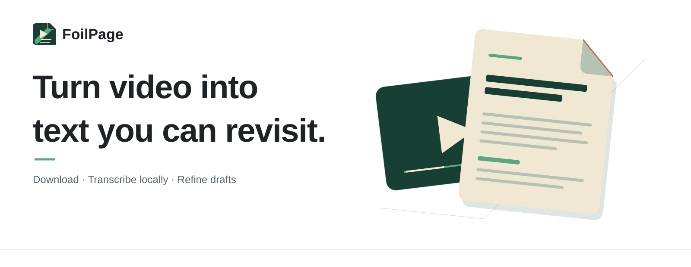
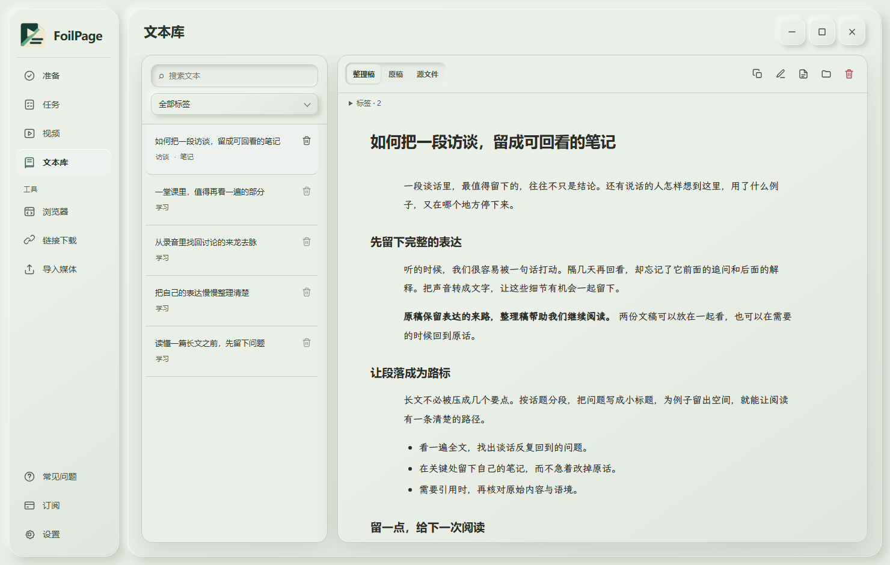

English · <a href="README.zh-CN.md">简体中文</a>

  <picture>
    <source media="(prefers-color-scheme: dark)" srcset="assets/home/hero-en-dark.svg">
    
  </picture>

  <a href="https://github.com/Ansel-Poiesis/FoilPage-releases/releases/latest"><picture>
    <source media="(prefers-color-scheme: dark)" srcset="assets/home/button-download-en-dark.svg">
    
  </picture></a>
  <a href="docs/guide.md"><picture>
    <source media="(prefers-color-scheme: dark)" srcset="assets/home/button-guide-en-dark.svg">
    
  </picture></a>

## From video to a page you can revisit

FoilPage brings video download, on-device transcription, and draft editing into one workspace. Keep the original transcript; refine a separate draft when you need one.

<picture>
  <source media="(prefers-color-scheme: dark)" srcset="assets/home/workspace-dark.png">
  
</picture>

## Capture, transcribe, keep reading

- **Bring content in.** Paste a supported Douyin, Bilibili, or YouTube link, or import a local video or audio file.
- **Transcribe on Windows.** Run the local model on CPU; NVIDIA acceleration is optional.
- **Keep both versions.** Read the source transcript and an edited draft side by side.
- **Continue from your browser or agent.** Pair the Chrome or Edge extension, or connect through MCP and CLI.

## Local first. Cloud when you choose.

| Work | Where it runs | Billing |
| :--- | :--- | :--- |
| Local transcription | Your PC | No cloud credits |
| Hosted text cleanup and title edits | FoilPage service | Current in-app plan |
| Your own API | Your provider | Provider billing |

Local transcription stays on your PC. When you choose a cloud text service, the text for that operation is sent to the selected service. Only process content you have the right to use.

## Start in three steps

1. Download the latest Windows release and install FoilPage.
2. Open **Prepare** to sign in, check your environment, choose a save folder, and download a local model.
3. Paste a video link or import media. Follow the task in **Tasks**, then read and edit it in **Library**.

FoilPage supports 64-bit Windows 10 version 1809 and later, and Windows 11. No Python or Node.js installation is required.

## Questions

<strong>Do I need an NVIDIA GPU?</strong>

No. CPU transcription is available; the NVIDIA GPU pack is optional.

<strong>Does local transcription upload my video?</strong>

No. Local transcription runs on your PC. Cloud text tools run only when you choose them.

<strong>Can I use the browser extension or connect an agent?</strong>

Yes. Pair the extension from **Browser** in FoilPage. MCP and CLI options are under **Settings → Agent control**.

## Guides and feedback

- [Setup guide](docs/guide.md)
- [Latest releases](https://github.com/Ansel-Poiesis/FoilPage-releases/releases)
- [Report an issue](https://github.com/Ansel-Poiesis/FoilPage-releases/issues/new/choose)

When reporting a problem, include the FoilPage version, Windows version, and steps to reproduce. Remove email addresses, codes, private text, and signed media links from screenshots or logs.

---

<strong>FoilPage</strong> © 2026 Ansel-Poiesis · @玩家川行出品

