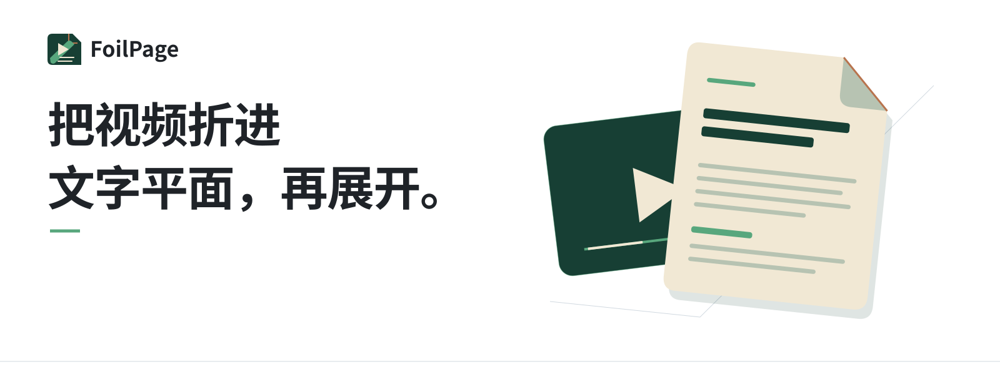

> 现行简体中文官网已上线：[打开 FoilPage 官网](https://foilpage.early-snipe-7202.chatgpt.site/?lang=zh)。中英切换在官网内完成；下方保留此前的仓库说明。

<a href="README.md">English</a> · 简体中文

  <picture>
    <source media="(prefers-color-scheme: dark)" srcset="assets/home/hero-zh-dark-v2.svg">
    
  </picture>

  <a href="https://github.com/Ansel-Poiesis/FoilPage-releases/releases/latest"><picture>
    <source media="(prefers-color-scheme: dark)" srcset="assets/home/button-download-zh-dark.svg">
    
  </picture></a>
  <a href="docs/guide.zh-CN.md"><picture>
    <source media="(prefers-color-scheme: dark)" srcset="assets/home/button-guide-zh-dark.svg">
    
  </picture></a>

## 把时间流折入文字平面

视频沿时间展开。FoilPage 像一张二向箔，将片段折入文字平面：转写原稿留住表达的来路，整理稿继续展开结构。你可以回到原文、编辑文稿，再接着阅读。

<picture>
  <source media="(prefers-color-scheme: dark)" srcset="assets/home/workspace-dark.png">
  
</picture>

## 从链接到文稿

- **收进内容。** 粘贴抖音、哔哩哔哩或 YouTube 视频链接，也可导入本地视频和音频。
- **在本机转写。** 可用 CPU 运行本地模型；NVIDIA GPU 加速包为可选项。
- **留下两份文稿。** 原稿保留表达来路，整理稿供继续阅读和编辑。
- **从浏览器或 Agent 接续。** 配对 Chrome / Edge 扩展，或通过 MCP、CLI 管理文稿与任务。

## 本地优先，云端按需

| 内容 | 处理位置 | 费用 |
| :--- | :--- | :--- |
| 本地转写 | 你的电脑 | 不消耗云端积分 |
| 托管文字整理与标题优化 | FoilPage 服务 | 以应用内当前报价为准 |
| 自带 API | 你选择的服务商 | 按服务商规则计费 |

本地转写在电脑上完成。只有你选择云端文字服务时，该次操作的文本才会发往对应服务。请只处理你有权使用的内容。

## 三步开始

1. 下载最新版 Windows 安装包并安装 FoilPage。
2. 打开「准备」，完成邮箱登录、环境检测、保存目录设置和本地模型下载。
3. 粘贴视频链接或导入媒体，在「任务」查看进度，再到「文本库」阅读和编辑。

支持 64 位 Windows 10 1809 及以上版本、Windows 11。无需安装 Python 或 Node.js。

## 常见问题

<strong>没有 NVIDIA 显卡，可以转写吗？</strong>

可以。CPU 转写可用，NVIDIA GPU 加速包为可选项。

<strong>本地转写会上传视频吗？</strong>

不会。本地转写在电脑上完成；只有主动选择云端文字服务时才会发送该次处理所需的文本。

<strong>可以连接浏览器扩展或 Agent 吗？</strong>

可以。在 FoilPage 的「浏览器」页配对扩展；MCP 和 CLI 位于「设置 → Agent 控制」。

## 指南与反馈

- [安装与使用指南](docs/guide.zh-CN.md)
- [最新发行版](https://github.com/Ansel-Poiesis/FoilPage-releases/releases)
- [反馈问题](https://github.com/Ansel-Poiesis/FoilPage-releases/issues/new/choose)

反馈时请附 FoilPage 版本、Windows 版本和复现步骤。截图或日志中请移除邮箱、验证码、私人文稿和带签名的媒体链接。

---

<strong>FoilPage</strong> © 2026 Ansel-Poiesis · @玩家川行出品

